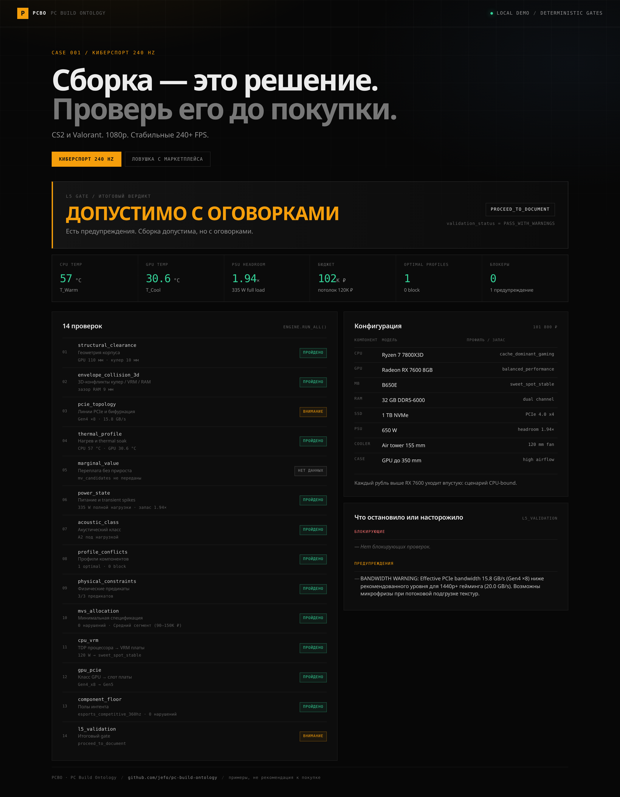
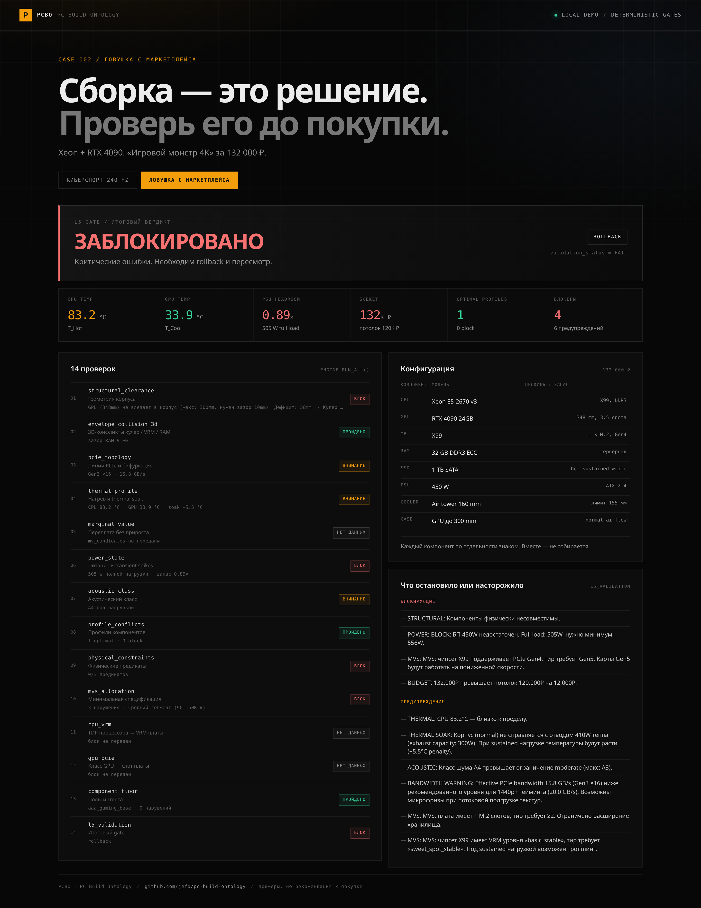

# PCBO — PC Build Ontology

**Детерминированный слой проверки между языковой моделью и покупкой железа.**

[](#запуск)
[](#ограничения)
[](LICENSE)

---

## Паспорт кейса

| | |
|---|---|
| **Роль** | автор онтологии и движка |
| **Контекст** | контент-проект о PC-железе и разбор сборок с маркетплейсов |
| **Задача** | отделить рассуждение LLM от физической проверки конфигурации |
| **Стек** | Python 3.11, YAML, Markdown/YAML frontmatter, JSON |
| **Состояние** | research/lab: 14 детерминированных проверок, 2 демо-сборки, self-test контрактов |
| **Что демонстрирует** | ontology engineering, constraint validation, fail-closed gates, traceability |

---

## Что это

PCBO — онтология и набор детерминированных валидаторов для PC-сборок. Не каталог железа, не прайс и не «лучшие сборки месяца». Это формальная модель того, как из цели, контекста и ограничений получается сборка, которую можно проверить, объяснить и защитить.

Проще говоря: LLM предлагает конфигурацию, а PCBO отвечает на вопрос, **разрешена ли она физически**.

```text
Запрос пользователя
        │
        ▼
LLM: «что, вероятно, нужно собрать»
        │   кандидат + обоснование
        ▼
PCBO: «что действительно допустимо»
        │   PASS / PASS_WITH_WARNINGS / FAIL
        ▼
Build Artifact: решение + альтернативы + trade-offs + риски
```

Это не замена инженеру. Это способ не дать модели уверенно предложить сборку, которая не влезает в корпус, не тянет по питанию или упирается в VRM.

---

## Проблема

Языковая модель хорошо рассуждает о железе и плохо проверяет физику. Типичные ошибки:

- GPU на 348 мм в корпус с лимитом 300 мм;
- Ryzen 7 с TDP 120W на плате с базовым VRM;
- БП на 450W для системы с полным потреблением 505W;
- RX 7600 в сборку под нативный 4K;
- бюджет 132 000 ₽ при потолке 120 000 ₽.

Человек ловит это вручную. Проверка одной сборки — от часа до вечера, если сверять сокеты, длины, TDP, линии PCIe, BIOS и доступность. Модель ловит это ещё хуже: у неё нет ни рулетки, ни даташита, ни чувства физики.

PCBO разворачивает задачу: **не просить LLM быть правым, а проверить его предложение до покупки.**

---

## Идея

Три принципа.

**1. Рассуждение и власть разделены.**  
LLM интерпретирует запрос, предлагает кандидатов и объясняет выбор. Домен проверяет инварианты. Модель не может «разрешить» физически невозможную сборку — она может только предложить её.

**2. Сборка — это Decision Artifact, а не список деталей.**  
У каждого выбора есть кандидаты, отклонённые альтернативы, критерии, обоснование, trade-off и риск. Если решение нельзя проверить — это не решение.

**3. Fail closed.**  
Нет данных — это `SKIP`, а не `PASS`. Неизвестный чипсет, отсутствующий профиль компонента или незаданный интент не должны молча превращаться в зелёную галочку.

---

## Как устроено

### Онтология

Семь уровней, каждый отвечает на свой вопрос:

| Слой | Вопрос | Где |
|---|---|---|
| **L1 Intent / Context / Workload** | Зачем и в каких условиях? | [`ontology/intent.md`](ontology/intent.md), [`ontology/context.md`](ontology/context.md), [`ontology/L1_intent/workload.md`](ontology/L1_intent/workload.md) |
| **L2 Constraint** | Что физически возможно? | [`ontology/L2_constraint/`](ontology/L2_constraint/) |
| **L3 Behavior** | Как система ведёт себя? | [`ontology/L3_behavior/`](ontology/L3_behavior/) |
| **L4 Decision** | Почему выбран этот компонент? | [`ontology/decision.md`](ontology/decision.md) |
| **L5 Validation** | Можно ли это собирать? | [`ontology/L5_validation/validation.md`](ontology/L5_validation/validation.md) |
| **L6 Lifecycle** | Что будет через 2–5 лет? | [`ontology/lifecycle.md`](ontology/lifecycle.md) |
| **Reasoning** | Как синтезировать и распределить бюджет? | [`ontology/reasoning/`](ontology/reasoning/) |

### Движок

14 детерминированных проверок. Ни одна не вызывает LLM.

| Проверка | Что ловит |
|---|---|
| `structural_clearance` | GPU/кулер не влезают, нет монтажного зазора |
| `envelope_collision_3d` | 3D-конфликт кулера, VRM-радиатора и RAM |
| `pcie_topology` | Деградация линий, бифуркация, DRAM-less SSD |
| `thermal_profile` | Взаимный нагрев, thermal soak, троттлинг |
| `marginal_value` | Переплата без прироста производительности |
| `power_state` | Нехватка БП, отсутствие ATX 3.0 под transient spikes |
| `acoustic_class` | Шум выше ограничения интента |
| `profile_conflicts` | Компонент `optimal` / `BLOCK` под конкретный intent |
| `physical_constraints` | Бинарные физические предикаты |
| `mvs_allocation` | Дисбаланс бюджета, слоты, PCIe gen, VRAM, RAM |
| `cpu_vrm` | TDP процессора выше класса VRM платы |
| `gpu_pcie` | Класс GPU выше возможностей слота |
| `component_floor` | Минимальные требования интента к CPU/GPU/RAM |
| `l5_validation` | Итоговый вердикт и rollback |

Плюс `pass_contract` — трассировка каждого прохода: вход, выход, контракт, `PASS` / `FAIL` / `SKIP` / `ERROR`.

---

## Демо

Статическая демо-страница: [`docs/index.html`](docs/index.html). Открывается локально без сборки. Если включить GitHub Pages для папки `docs/`, она будет доступна по адресу `https://jefo.github.io/pc-build-ontology/`.

**Валидная сборка — `PASS_WITH_WARNINGS`**

[](docs/screenshots/demo-valid.png)

**Ловушка с маркетплейса — `FAIL`**

[](docs/screenshots/demo-trap.png)

Открыть локально:

```bash
python3 -m http.server 8000 -d docs
# http://localhost:8000/?scenario=xeon-rtx4090-trap
```

### Валидная сборка: киберспорт 1080p / 240Hz

```bash
python -m engine.run_all < examples/esports-240hz/build.json
```

Результат:

```json
{
  "validation_status": "PASS_WITH_WARNINGS",
  "action_required": "proceed_to_document",
  "failed_check_ids": [],
  "warnings": [
    "BANDWIDTH WARNING: Effective PCIe bandwidth 15.8 GB/s (Gen4 ×8) ..."
  ]
}
```

Что проверил движок:

- GPU 240 мм в корпусе до 350 мм — зазор 110 мм;
- CPU 57.0 °C, GPU 30.6 °C, thermal soak не активен;
- БП 650W при полной нагрузке 335W — запас 1.94×;
- VRM B650E соответствует CPU 120W;
- профиль RX 7600 `optimal` для `esports_1080p_240hz`;
- предупреждение по PCIe ×8 осталось честно на месте.

### Ловушка с маркетплейса: Xeon + RTX 4090

```bash
python -m engine.run_all < examples/xeon-rtx4090-trap/build.json
```

Результат:

```json
{
  "validation_status": "FAIL",
  "action_required": "rollback",
  "failed_check_ids": [
    "STRUCTURAL: Компоненты физически несовместимы.",
    "POWER: BLOCK: БП 450W недостаточен. Full load: 505W, нужно минимум 556W.",
    "MVS: чипсет X99 поддерживает PCIe Gen4, тир требует Gen5.",
    "BUDGET: 132,000₽ превышает потолок 120,000₽ на 12,000₽."
  ]
}
```

Разбор каждого вердикта — в [`docs/WALKTHROUGH.md`](docs/WALKTHROUGH.md).

---

## Запуск

Нужен Python 3.11+.

```bash
git clone https://github.com/jefo/pc-build-ontology.git
cd pc-build-ontology

python3 -m venv .venv
source .venv/bin/activate
pip install -r requirements.txt

# оба демо
python -m engine.run_all < examples/esports-240hz/build.json
python -m engine.run_all < examples/xeon-rtx4090-trap/build.json

# self-test контрактов
python engine/test_pass_contract.py

# пересобрать данные демо после изменения примеров
python tools/build_demo_data.py
```

Если установлен `make`, есть короткие цели:

```bash
make demo
make test
```

Или напрямую, без venv:

```bash
python -m engine.run_all < examples/esports-240hz/build.json
python engine/test_pass_contract.py
```

Движок читает входной JSON из stdin и печатает результат в stdout. Полный формат входа описан в [`docs/ARCHITECTURE.md`](docs/ARCHITECTURE.md).

---

## Что показывает этот кейс

Это не «я написал валидатор». Это пример инженерной работы с доменом:

- **Онтология вместо промпта.** Ограничения, метрики и trade-offs зафиксированы в документах и YAML, а не в голове модели.
- **Decision Artifact вместо списка деталей.** У выбора есть кандидаты, отклонения, критерии и риск.
- **Детерминированный gate вместо доверия.** Финальный вердикт выносит код, а не Language Model.
- **Traceability.** `pass_contract` показывает, что именно проверялось и где данные закончились.
- **Честные ограничения.** Движок умеет говорить `SKIP`, а не только `PASS`.
- **Конфиг как данные.** Пороги TDP→VRM, бюджеты и floors лежат в YAML; код не переписывается при смене рынка.
- **Разделение ответственности.** LLM предлагает, инженер решает, домен запрещает.

---

## Ограничения

- **Это исследовательский проект, не продукт.** Нет API, веб-интерфейса, базы данных и SLA.
- **Демо-база знаний минимальна.** В `examples/kb/` три карточки. Полная база — отдельный репозиторий `kaizin-lab/pc_hardware_knowledge_base`.
- **Цены и модели устаревают.** `budget_tiers.yaml` привязан к рынку РФ на июнь 2026. Перед использованием обновите пороги.
- **Парсер интента не детерминирован.** `STATE_0.5` всё ещё делает LLM. Это известный разрыв: вход в движок должен быть воспроизводимым.
- **Профили есть не у всех компонентов.** GPU/CPU покрыты лучше, чем RAM, SSD, PSU и корпуса.
- **Правила консервативны.** Например, средний бюджетный тир требует PCIe Gen5, поэтому B650/Gen4 получает `BLOCK` в MVS. Это осознанное ужесточение, а не истина.
- **Примеры — не рекомендация к покупке.** Это тестовые данные для проверки логики.

---

## Дорожная карта

1. `parse_intent.py` — детерминированный маппер «запрос → intent».
2. Полные профили для RAM, SSD, PSU, cooling и case.
3. Генератор Build Artifact из результата движка.
4. CLI: `pcbo validate build.json` и `pcbo explain build.json`.
5. Веб-отчёт «светофор» для готовой сборки.
6. Публичный набор эталонных сборок: валидные и намеренно сломанные.

---

## Структура

```text
ontology/              онтология L1–L6 + reasoning
  intent.md            целевая функция сборки
  context.md           условия эксплуатации
  decision.md          Decision, Rationale, TradeOff, Risk
  template.md          шаблон Build Artifact
engine/                детерминированные валидаторы
  run_all.py           оркестратор 14 проверок
  pass_contract.py     трассировка проходов
  *_tiers.yaml         пороги и правила
examples/
  esports-240hz/       валидная сборка + ожидаемый вывод
  xeon-rtx4090-trap/   сборка с блокирующими ошибками
  kb/                  демо-карточки компонентов
docs/
  index.html           статическое демо
  demo.css / demo.js   интерфейс демо
  data.js              данные демо (генерируется из examples/)
  screenshots/         скриншоты валидной и проваленной сборки
  ARCHITECTURE.md      слои, контракты, формат входа
  WALKTHROUGH.md       разбор двух примеров
tools/
  build_demo_data.py   examples/ → docs/data.js
  screenshot_demo.py   docs/ → docs/screenshots/
```

---

## Благодарности

Кейс вырос из контент-проекта **«Железный Аргумент» / ИгроЛаба** — разбора готовых сборок с маркетплейсов и инженерных решений вместо «топ за свои деньги».

База компонентов и профилей: [`kaizin-lab/pc_hardware_knowledge_base`](https://github.com/kaizin-lab/pc_hardware_knowledge_base).

---

## Лицензия

MIT. См. [`LICENSE`](LICENSE).
